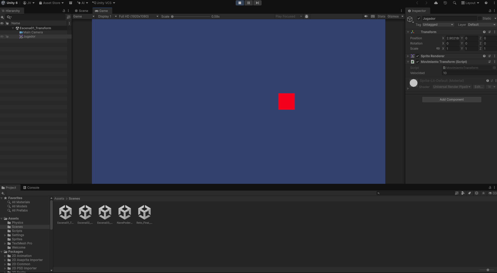
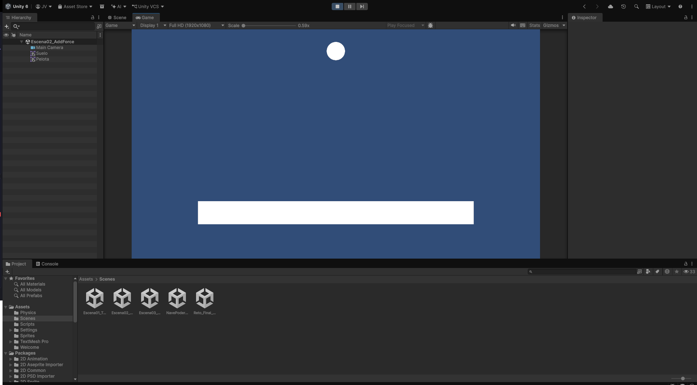
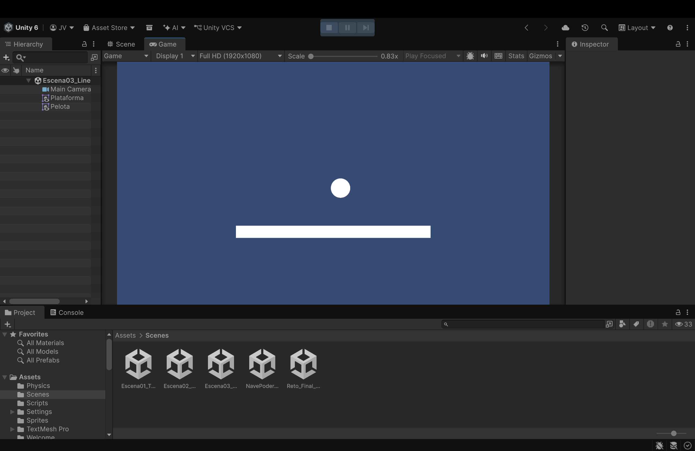

# Notas
Videojuego

## Ejercicio 1 — Movimiento directo con Transform

* **¿Qué sucede cuando duplicas la velocidad?**
  R= El objeto comienza a desplazarse con más fluidez en el eje x

* **¿Cambiar la escala modifica la velocidad?**
  R= No, solo hará que visualmente ocupe mas espacio horizontalmente y menos verticalmente.

* **¿Por qué el objeto puede seguir desplazándose sin tener un Rigidbody2D?**
  R= Porque el objeto solo está moviendose entre coordenadas, es decir, solo está desplazándosela en eje x, no tiene físicas de caída o peso añadidas

* **¿Qué pasaría si intentaras utilizar este mismo enfoque para simular una pelota que rebota sobre una plataforma?**
  R= Fallaría debido que para que la pelota rebote necesitamos físicas y al estar con un objeto sin rigidbody la pelota atravesaría el objeto y caería al infinito

---

## Ejercicio 2 — Impulsos y fuerzas con Rigidbody2D

* **¿Qué sucede cuando aumentas la fuerza del impulso?**
  R= El objeto se eleva mas en el eye vertical

* **¿Qué cambia cuando Gravity Scale es igual a cero?**
  R= La pelota ya no desciende y comienza a elevarse lentamente de acuerdo a la fuerza aplicada, mientras menos sea la fuerza menos es lo que tarda en frenar, al contrario si aplicamos mas fuerza el objeto comienza a elevarse cada vez más.

* **¿Por qué la pelota cae más rápidamente cuando aumentas la escala de gravedad?**
  R= Porque al obtener más atracción hacía abajo el objeto tiende a descender con mayor velocidad

* **¿Qué diferencia hay entre mantener una fuerza continua y aplicar un impulso?**
  R= Al aplicar una fuerza continua el objeto no tendrá una fuerza opuesta que lo arrastre hacía abajo, mientras que al aplicar un impulso se aplica una fuerza de un solo momento.

* **¿Qué función cumple el Rigidbody2D en esta escena?**
  R= En el caso de la pelota define la colisión con otro objeto, la masa del objeto y la gravedad aplicada, al verse modificados estos aspectos hacen que la pelota sea mas pesada, con la gravedad que no tenga caída o al contrario obtener mayor fuerza y velocidad de caída

---

## Ejercicio 3 — Velocidad, gravedad y colisiones

* **¿Por qué la pelota comienza a moverse horizontalmente?**
  R= Porque usamos linearVelocity en el vector 2 aplicando la velocidadHorizontal de 4f para que empiece con una fuerza horizontal al iniciar la simulación.

* **¿Por qué termina cayendo si su velocidad vertical inicial es cero?**
  R= Inicia en 0 pero la gravedad por si sola permita que gane velocidad al iniciar la simulación.

* **¿Qué diferencia observas entre asignar linearVelocity y aplicar un impulso con AddForce()?**
  R= con linearVelocity aplico una fuerza inicial ignorando toda aquella fuerza con la que ya viene y Addforce  aplica una fuerza de golpe, pero toma en cuenta la velocidad e inercia previa del objeto.

* **¿Qué sucede cuando desactivas la gravedad?**
  R= Cuando desactivo la gravedad el objeto no caerá y seguirá una trayectoria en el eje x de acuerdo a la fuerza aplicada hasta detenerse eventualmente.

* **¿Qué papel desempeñan los colliders?**
  R= Los colliders permiten al objeto detectar la interacción o choque con otros objetos

* **¿Por qué cambiar el material físico puede modificar el rebote?**
  R= Permite que con la fuerza del rebote se aplique una fuerza como una reacción de rechazo acorde a la fuerza con la que viene el objeto con el que colisiona.

* **Linear Damping:**
  Aplica una fuerza o lentitud como si fuera una pared invisible que dificulta el movimiento

---

## Tabla de Pruebas

| Prueba | Fuerza de nave | Gravedad de pelota | Resultado observado |
| :---: | :---: | :---: | :--- |
| **1** | 4 | 1 | La fuerza reducida de la nave fue insuficiente para desplazarla con rapidez, lo que provocó que el impacto de la pelota la desequilibrara y volcara con facilidad al no alcanzar a cubrir el extremo a tiempo. |
| **2** | 8 | 1 | Al duplicar la fuerza, la nave respondió con mayor agilidad; sin embargo, al no haber amortiguamiento o control de inercia, la pelota generó un impacto brusco en los extremos que terminó volteando la nave repentinamente. |
| **3** | 8 | 2 | La pelota cae con mayor velocidad y aplicando más fuerza al impactar con la nave, al tener mas gravedad aplicada el rebote se dificulta por ende aparenta ser más pesado. |

## Reflexión final

1. **¿En qué se diferencia Transform.Translate() de Rigidbody2D.AddForce()?**

Transform.Translate() mueve el objeto modificando sus coordenadas, sin involucrar físicas ni masa. Al contrario de Rigidbody2D.AddForce() que aplica una fuerza sobre un objeto físico, la cual interactúa con la masa y las colisiones del entorno.

2. **¿Qué diferencia hay entre aplicar un impulso y asignar linearVelocity?**

Asignar linearVelocity establece una velocidad inicial directa ignorando la inercia o la fuerza con la que el objeto ya venía, mientras que al aplicar con AddForce() ejerce una fuerza de golpe que se suma con la velocidad e inercia previa del objeto.

3. **¿Qué papel desempeña la gravedad?**

Actúa como una fuerza constante que atrae los objetos hacia abajo haciendo que los objetos ganen velocidad y desciendan de acuerdo a los valores de la gravedad aplicados.

4. **¿Por qué necesitamos colliders para detectar contactos físicos?**
Porque los colliders definen la forma y los límites de los objetos; sin ellos, el motor de físicas que usa Unity no sabría en qué momento exacto ocurre un choque o interacción y los elementos se atravesarían mutuamente.

5. **¿Qué propiedad modificaste para mejorar el equilibrio?**

Modifiqué la fuerza de desplazamiento de la nave y la gravedad aplicada a la pelota, además modifiqué en Constraints el freeze rotation z para evitar que al rebotar con la nave esta se volteé con la fuerza aplicada por la pelota y así facilitar el juego.

6. **¿Qué problema encontraste durante las pruebas y cómo lo resolviste?**

El principal problema fue que el impacto de la pelota desequilibraba y volcaba la nave fácilmente, y en otras pruebas el empuje era demasiado brusco en los extremos. Lo resolví experimentando con distintas combinaciones de fuerza en la nave y escala de gravedad en la pelota para comprender cómo equilibrar el peso y la velocidad de reacción de la nave.

7. **Si tuvieras que construir un proyectil, ¿qué técnica elegirías y por qué?**

Elegiría linearvelocity o un impulso con AddForce(), ya que al tratarse de un proyectil necesito que responda a la física, tenga velocidad inicial controlada y pueda colisionar o verse afectado por la gravedad al ser disparado (esto siendo opcional).

8. **¿Qué cambiarías si quisieras una nave que se desplazara de manera más controlada y sin inercia?**

Ahora que comprendí y descubrí Linear Damping jugaría con su configuración para aumentar la fuerza o fricción que me permite aplciar para que la nave frene al instante en cuanto el jugador deje de presionar las teclas.